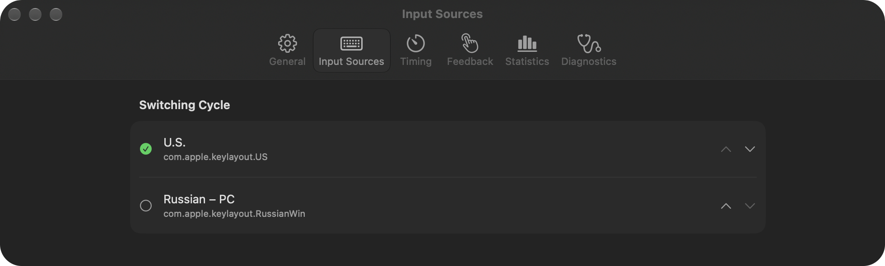
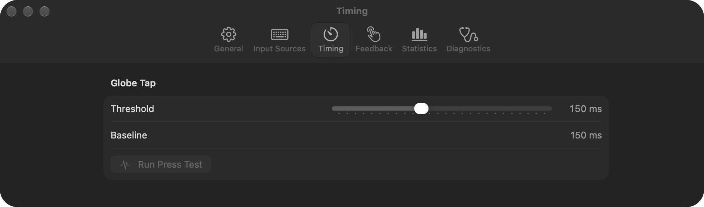
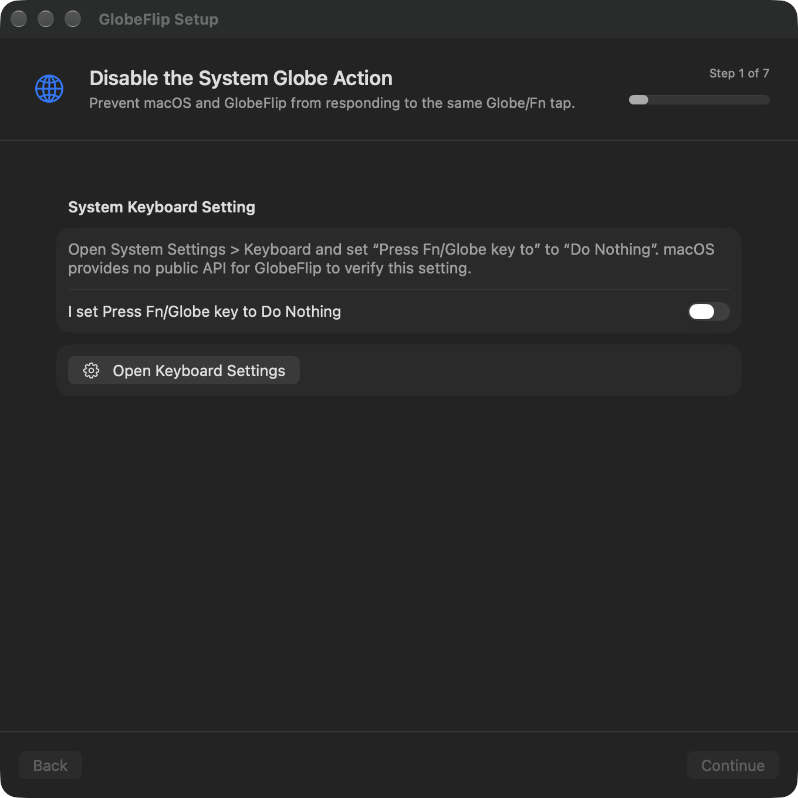

# GlobeFlip

<p align="center">
  
  
</p>

[](https://github.com/Martyrer/GlobeFlip/actions/workflows/ci.yml)

GlobeFlip is a macOS menu bar utility that switches enabled Input Sources after
a standalone Globe/Fn tap while leaving native Fn events unchanged.

## Install

Requires an Apple Silicon Mac with macOS 26 or newer.

- Homebrew: `brew install --cask martyrer/tap/globeflip`
- Manual: download `GlobeFlip-<version>-arm64.zip` from GitHub Releases, verify
  it against the matching `.sha256`, and move GlobeFlip.app to /Applications.

GlobeFlip is ad-hoc signed and not notarized. On first launch macOS blocks it:
open System Settings > Privacy & Security, choose **Open Anyway**, and confirm.
Do not disable Gatekeeper globally.

## Build from Source

Requires Xcode 26 or newer and XcodeGen 2.46 or newer.

`project.yml` is authoritative. Generate the ignored Xcode project before
using `xcodebuild` or opening it in Xcode:

```sh
xcodegen generate
xcodebuild \
  -project GlobeFlip.xcodeproj \
  -scheme GlobeFlip \
  -derivedDataPath DerivedData \
  CODE_SIGNING_ALLOWED=NO \
  test
```

## Setup

<p align="center">
  
</p>

1. In System Settings > Keyboard, set **Press Fn/Globe key to** to
   **Do Nothing**.
2. Confirm that setting in GlobeFlip.
3. Choose **Allow Input Monitoring** in GlobeFlip.
4. If macOS does not grant access immediately, open System Settings > Privacy &
   Security > Input Monitoring, enable GlobeFlip, then choose **Check Again**.

GlobeFlip cannot verify the first setting through a public macOS API.

## Permissions

Input Monitoring is the only required permission. A listen-only event tap uses
it to observe the Globe/Fn key. Notification permission is optional and only
requested if you enable failure notifications. GlobeFlip does not request
Accessibility and makes no network requests. See [SECURITY.md](SECURITY.md).

## Troubleshooting

- A tap does nothing: check that System Settings > Keyboard > **Press Fn/Globe
  key to** is **Do Nothing**, and that GlobeFlip is enabled under Input
  Monitoring.
- After updating: each ad-hoc build has a new signature, so macOS drops the
  Input Monitoring grant. Remove GlobeFlip from the Input Monitoring list, add
  it again, then choose **Check Again**.
- Switching paused with a conflict warning: another Globe/Fn remapper is
  active. Disable it, then choose **Check Again**.

## Uninstall

1. Turn off Launch at Login in GlobeFlip's Settings.
2. Quit GlobeFlip.
3. Delete GlobeFlip.app, or run `brew uninstall --cask --zap globeflip`.
4. Run `tccutil reset ListenEvent com.martyrer.GlobeFlip`.
5. Run `defaults delete com.martyrer.GlobeFlip`.

## Contributing

See [CONTRIBUTING.md](CONTRIBUTING.md) for architecture, local signing so the
Input Monitoring grant survives rebuilds, and pull request expectations.
Privacy guarantees are in [SECURITY.md](SECURITY.md).

## License

MIT. See [LICENSE](LICENSE).
